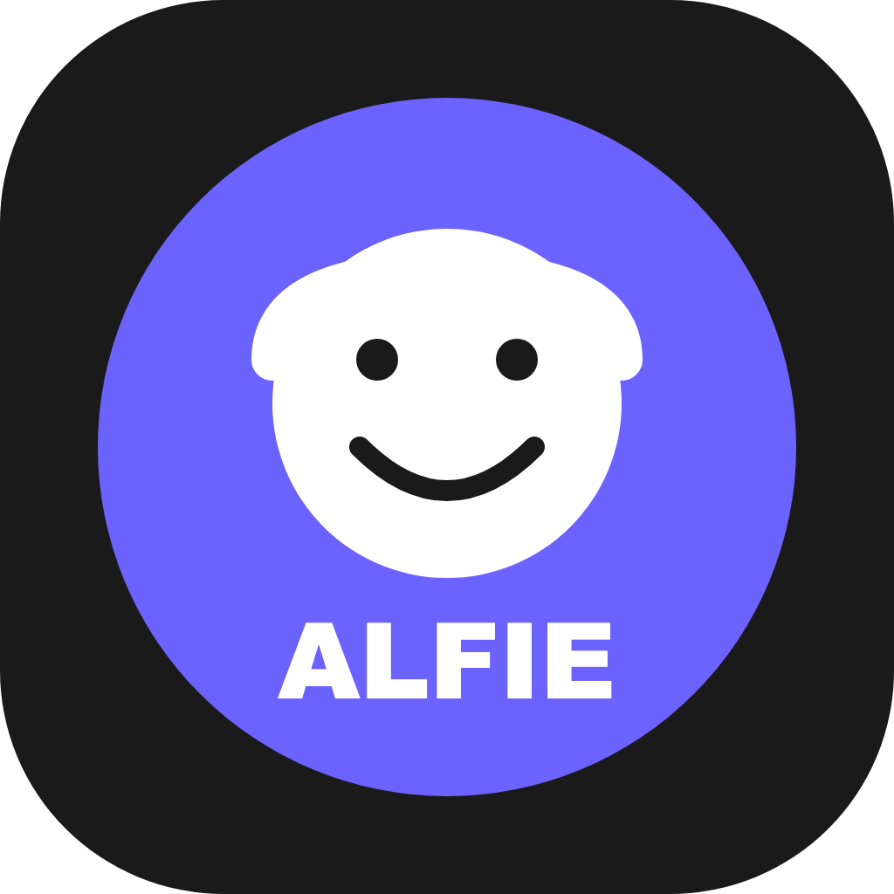
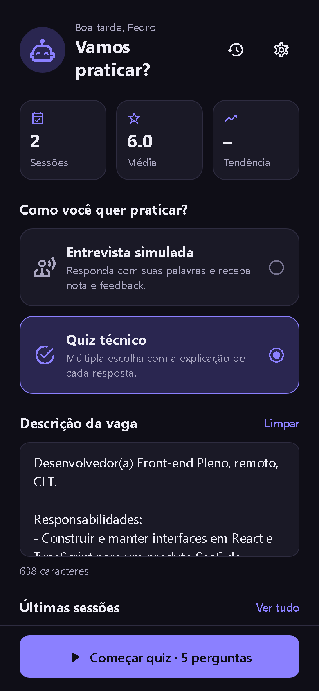
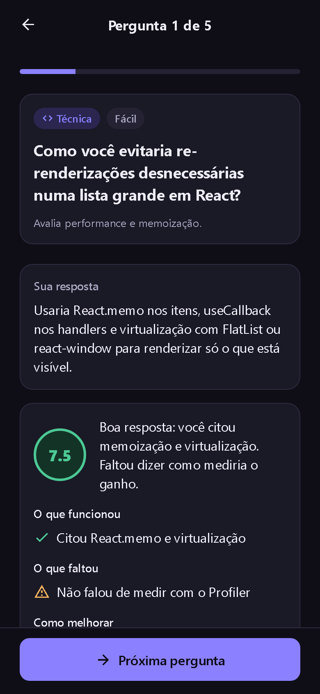
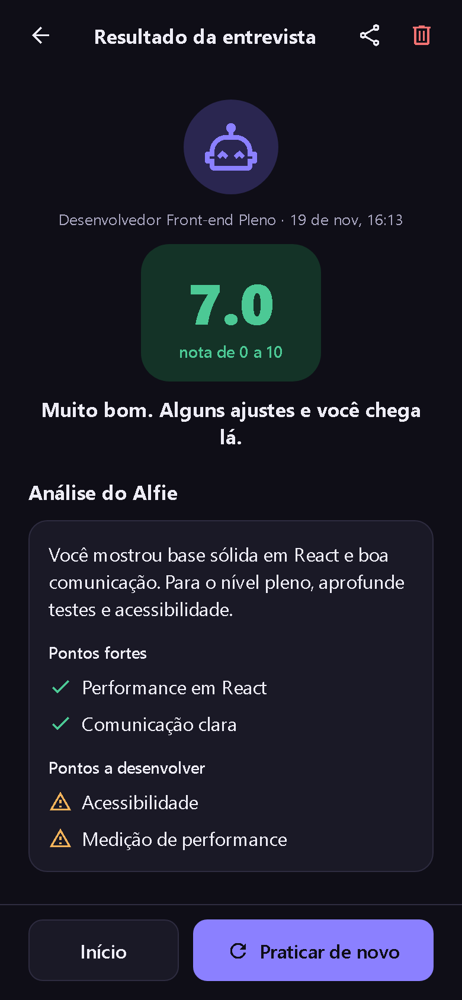
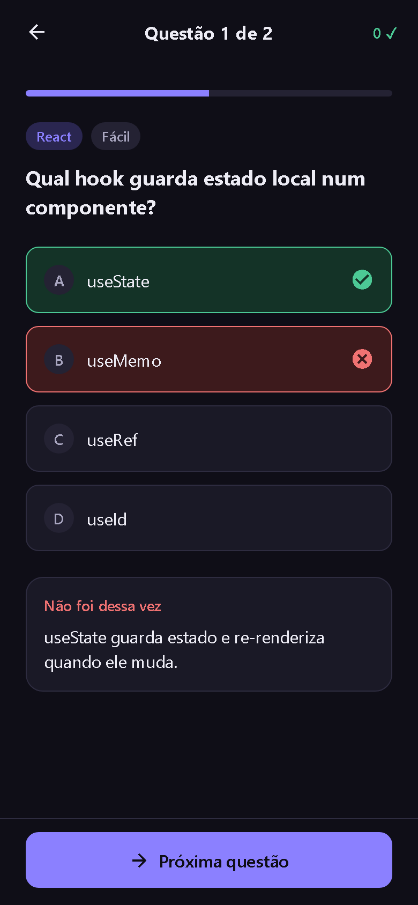
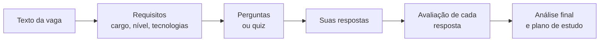

<p align="center"></p>
<h1 align="center">Alfie</h1>
<p align="center"><em>Treine entrevistas de tecnologia com IA, sob medida para a vaga que você quer.</em></p>
<p align="center">
  <a href="https://github.com/pedrinholeda/Alfie-AI/actions/workflows/ci.yml"></a>
  <a href="LICENSE.md"></a>
  
</p>

<p align="center">
  
  
  
  
</p>

Treinar para entrevista sozinho é difícil: as perguntas genéricas da internet não têm nada a
ver com a vaga, e ninguém diz o que faltou na sua resposta.

O Alfie lê a descrição da vaga que você colou, monta perguntas técnicas e comportamentais do
nível certo, avalia cada resposta com nota e sugestões e, no fim, entrega uma análise com um
plano de estudo. Funciona no Android, no iOS e no navegador.

## O que faz

**Entrevista simulada**

- Perguntas técnicas e comportamentais tiradas dos requisitos, da senioridade e das tecnologias da vaga
- Nota de 0 a 10 em cada resposta, com o que funcionou, o que faltou e como melhorar
- Análise final do desempenho e um plano de estudo em passos
- Pule perguntas que não quiser responder; sair no meio pede confirmação

**Quiz técnico**

- Múltipla escolha com a explicação de cada questão e placar ao vivo
- No resultado, os temas que você errou para revisar

**Acompanhamento**

- Histórico no aparelho, com filtro por modo, média e tendência das últimas sessões
- Praticar de novo com a mesma vaga, compartilhar o resultado, apagar uma sessão
- Sessões curtas, padrão ou longas; tema claro, escuro ou do sistema

## Como funciona



Cada etapa é uma chamada ao Gemini, do Google, com a sua própria chave. Não existe servidor do
Alfie: a chave, o histórico e os ajustes ficam no aparelho. Arquitetura em
[docs/DESENVOLVIMENTO.md](docs/DESENVOLVIMENTO.md).

## Instalação

Você precisa do [Node.js](https://nodejs.org/) 20 ou mais novo e, para testar no celular, do
app [Expo Go](https://expo.dev/go).

```bash
git clone https://github.com/pedrinholeda/Alfie-AI.git
cd Alfie-AI
npm install
npm start
```

Escaneie o QR code com o Expo Go (Android) ou com a câmera (iOS). Para abrir no navegador,
aperte `w` no terminal ou rode `npm run web`.

## Primeiro uso

1. Veja a apresentação e diga como quer ser chamado.
2. Crie uma chave gratuita no [Google AI Studio](https://aistudio.google.com/app/apikey) e cole
   no app. Ele valida a chave e escolhe o modelo Gemini disponível.
3. Na tela inicial, escolha **Entrevista simulada** ou **Quiz técnico**, cole a descrição da
   vaga (ou toque em **Usar um exemplo**) e comece.

## Configuração

Tudo se ajusta no app, em **Ajustes**: nome, chave, tamanho das sessões, tema e apagar dados.

| arquivo                                            | o que muda                                                                                |
| -------------------------------------------------- | ----------------------------------------------------------------------------------------- |
| [`src/config/practice.ts`](src/config/practice.ts) | quantas perguntas tem cada tamanho de sessão, tamanho mínimo da vaga, limite do histórico |
| [`src/config/ai.ts`](src/config/ai.ts)             | modelos Gemini em ordem de preferência, temperatura, tempo limite, novas tentativas       |
| [`src/prompts/index.ts`](src/prompts/index.ts)     | o que a IA pergunta e como avalia, com o tom do Alfie                                     |

Para não colar a chave a cada instalação durante o desenvolvimento, copie `.env.example` para
`.env` e preencha `EXPO_PUBLIC_GEMINI_API_KEY`: o campo da chave já vem preenchido. Não use
isso num build publicado, porque a variável vai junto no pacote.

## Perguntas frequentes

**Quanto custa?**
O Alfie é gratuito. O Gemini tem uma cota gratuita que cobre o uso de treino; acima dela, a
cobrança é do Google, na sua conta.

**Para onde vão meus dados?**
O texto da vaga e suas respostas vão só para a API do Gemini, para gerar e avaliar as
perguntas. A chave fica no cofre seguro do celular (Keychain ou Keystore); na versão web, no
armazenamento do navegador. Histórico e ajustes nunca saem do aparelho.

**Dá para colar o link da vaga?**
Não. A maioria dos sites de vaga bloqueia leitura automática, então o app pede o texto. Abra a
vaga, selecione tudo e cole.

**Funciona para vagas que não são de desenvolvimento?**
Sim. As perguntas saem da vaga: dados, design, produto, QA, infraestrutura e o que mais estiver
na descrição.

## Solução de problemas

| mensagem                                     | causa                                       | solução                                                            |
| -------------------------------------------- | ------------------------------------------- | ------------------------------------------------------------------ |
| A chave do Gemini não foi aceita             | chave copiada pela metade ou revogada       | crie outra no AI Studio e troque em Ajustes                        |
| O limite de uso da sua chave foi atingido    | cota gratuita do minuto ou do dia acabou    | espere alguns minutos e tente de novo                              |
| Sem conexão com o Gemini                     | sem internet ou rede bloqueando o Google    | confira a rede; em rede corporativa, tente outra                   |
| A resposta da IA veio num formato inesperado | o modelo devolveu algo que não dá para usar | toque em **Tentar de novo**; o app já tenta sozinho até duas vezes |

## Estrutura

```
App.tsx            rotas e provedores
src/screens/       uma tela por arquivo
src/components/    componentes de interface (ui.tsx) e peças compartilhadas
src/services/      cliente HTTP do Gemini
src/prompts/       os prompts, num arquivo só
src/lib/           regras puras, todas com teste
src/state/         estado global: perfil, ajustes, chave e histórico
src/storage/       AsyncStorage e cofre seguro
src/theme/         cores do tema claro e escuro, espaçamento e tipografia
src/config/        o que dá para ajustar sem ler o resto do código
```

O papel de cada módulo está em [docs/DESENVOLVIMENTO.md](docs/DESENVOLVIMENTO.md).

## Status e roadmap

O app roda na web e foi testado de ponta a ponta no navegador. O build nativo para as lojas
ainda não foi feito. O que vem a seguir está em [docs/ROADMAP.md](docs/ROADMAP.md); o que já
saiu, no [CHANGELOG](CHANGELOG.md).

## Contribuindo

Bug e PR são bem-vindos. Veja o [CONTRIBUTING.md](CONTRIBUTING.md).

## Licença

MIT, veja [LICENSE.md](LICENSE.md). Feito por [Pedro Leda](https://www.linkedin.com/in/pedroleda/).
