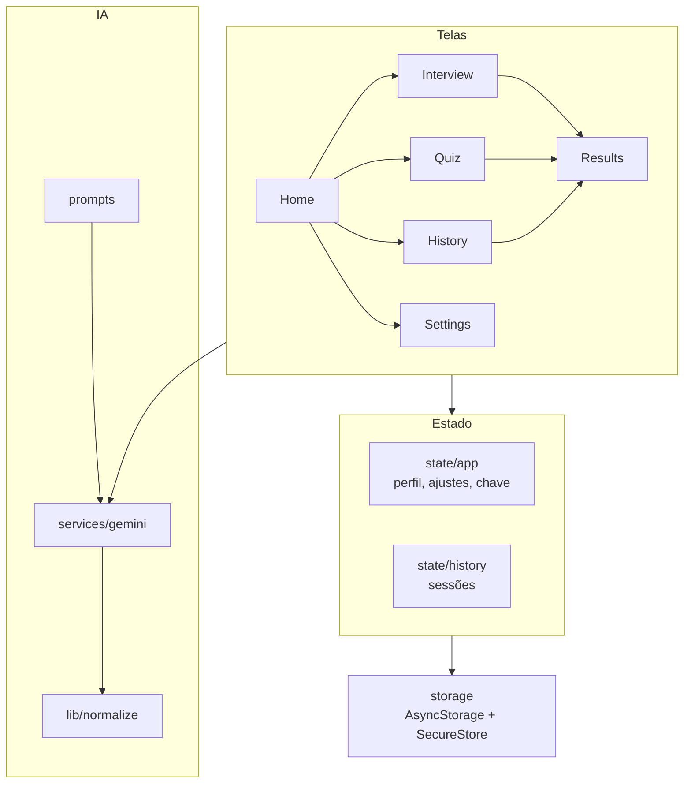

# Desenvolvimento

Como o Alfie é montado por dentro, para quem vai mexer no código.

## Visão geral

App [Expo](https://expo.dev/) (SDK 53, React Native 0.79, React 19) em TypeScript estrito, que
roda no Android, no iOS e na web com o mesmo código. Não há servidor: o app fala direto com a
API REST do Gemini usando a chave do usuário.

## Módulos

| caminho                           | papel                                                                                                             |
| --------------------------------- | ----------------------------------------------------------------------------------------------------------------- |
| `App.tsx`                         | provedores (área segura, estado, histórico, tema, aviso) e rotas por estado                                       |
| `src/screens/Introduction.tsx`    | apresentação, só na primeira abertura                                                                             |
| `src/screens/Onboarding.tsx`      | nome e chave do Gemini, com validação                                                                             |
| `src/screens/Home.tsx`            | escolher o modo, colar a vaga, progresso e últimas sessões                                                        |
| `src/screens/Interview.tsx`       | entrevista: resposta, avaliação, pular, análise final                                                             |
| `src/screens/Quiz.tsx`            | quiz com explicação e placar                                                                                      |
| `src/screens/Results.tsx`         | resultado lido do histórico, revisão, praticar de novo                                                            |
| `src/screens/History.tsx`         | lista com filtro e média                                                                                          |
| `src/screens/Settings.tsx`        | nome, chave, tamanho das sessões, tema, dados, sobre                                                              |
| `src/hooks/usePracticeStarter.ts` | lê a vaga, gera perguntas e navega; cancelável                                                                    |
| `src/services/gemini.ts`          | cliente HTTP: chave no cabeçalho, modo JSON, tempo limite, novas tentativas, troca de modelo                      |
| `src/prompts/index.ts`            | todos os prompts                                                                                                  |
| `src/lib/normalize.ts`            | confere e limpa cada resposta do modelo                                                                           |
| `src/lib/json.ts`                 | lê o JSON do modelo e recusa JSON cortado                                                                         |
| `src/lib/models.ts`               | escolhe o modelo entre os disponíveis para a chave                                                                |
| `src/lib/errors.ts`               | `AiError` com mensagens para o usuário e regra de nova tentativa                                                  |
| `src/lib/history.ts`              | notas, estatísticas, limite do histórico e migração da 1.0                                                        |
| `src/lib/jobText.ts`              | limpeza do texto da vaga e detecção de link                                                                       |
| `src/lib/share.ts`                | texto para compartilhar um resultado                                                                              |
| `src/lib/confirm.ts`              | confirmação que funciona no celular e na web                                                                      |
| `src/state/app.tsx`               | perfil, ajustes, chave; migração da 1.0 ao abrir                                                                  |
| `src/state/history.tsx`           | sessões salvas                                                                                                    |
| `src/storage/index.ts`            | chaves de armazenamento e cofre seguro                                                                            |
| `src/theme/index.tsx`             | tokens dos temas claro e escuro, `useTheme`, `useStyles`                                                          |
| `src/components/ui.tsx`           | `Screen`, `AppHeader`, `Button`, `Card`, `TextField`, `Segmented`, `Pill`, `ScoreBadge`, `EmptyState`, `ErrorBox` |
| `src/config/`                     | tamanhos de sessão, modelos e limites, vaga de exemplo                                                            |

## Fluxo de uma sessão

1. `usePracticeStarter.start` limpa o texto (`sanitizeJobInfo`) e pede os requisitos
   (`requirementsPrompt`). O resultado passa por `normalizeRequirements`.
2. Gera as perguntas: na entrevista, técnicas e comportamentais em paralelo; no quiz, um lote.
   O tamanho vem de `config/practice.ts`, conforme o ajuste do usuário.
3. A tela da prática guarda cada resposta. Na entrevista, cada uma é avaliada
   (`answerFeedbackPrompt`) e, no fim, vem a análise final (`finalAnalysisPrompt`). Se a
   análise falhar, a nota é a média das respostas avaliadas.
4. A sessão vai para o histórico e a tela de resultado abre pelo id. Por isso o resultado é o
   mesmo vindo da prática ou da lista.

## Chamadas ao Gemini

- Endpoint `generateContent` da API v1beta, com `responseMimeType: application/json`.
- A chave vai no cabeçalho `x-goog-api-key`, nunca na URL.
- Erro 429 ou cota esgotada e chave recusada não são repetidos; rede, tempo esgotado, 5xx e
  JSON ruim são repetidos até `aiConfig.retries` vezes, com espera crescente.
- Se o modelo salvo responder 404 (o Google desligou a versão), o cliente lista os modelos da
  chave, escolhe outro com `pickModel` e avisa o app para guardar a escolha.

## Armazenamento

| chave                | onde                                        | conteúdo                                              |
| -------------------- | ------------------------------------------- | ----------------------------------------------------- |
| `alfie.geminiApiKey` | SecureStore (celular) ou localStorage (web) | a chave                                               |
| `@alfie:profile`     | AsyncStorage                                | `{ name }`                                            |
| `@alfie:settings`    | AsyncStorage                                | tamanho das sessões, tema, apresentação vista, modelo |
| `@alfie:history`     | AsyncStorage                                | até 50 sessões completas                              |
| `@alfie:draft`       | AsyncStorage                                | o último texto de vaga digitado                       |

As chaves `@AlfieApp:*` da versão 1.0 são migradas e apagadas na primeira abertura.

## Testes

`npm test` roda o Jest com o preset `jest-expo`. Os testes cobrem tudo em `src/lib`, os prompts
e o cliente do Gemini (com `fetch` simulado). As telas ainda não têm teste automatizado; elas
foram conferidas de ponta a ponta na web com o Gemini simulado, nos dois temas, no celular e
no desktop.

## Build

- **Web**: `npx expo export --platform web` gera o site estático em `dist/`.
- **Android e iOS**: com o [EAS](https://docs.expo.dev/build/introduction/), `npx eas build`.
  O `eas.json` ainda não existe; veja o roadmap.
- Os ícones saem de `src/assets/*.svg` com `scripts/generate-icons.sh` (precisa de ImageMagick
  e svgexport).
